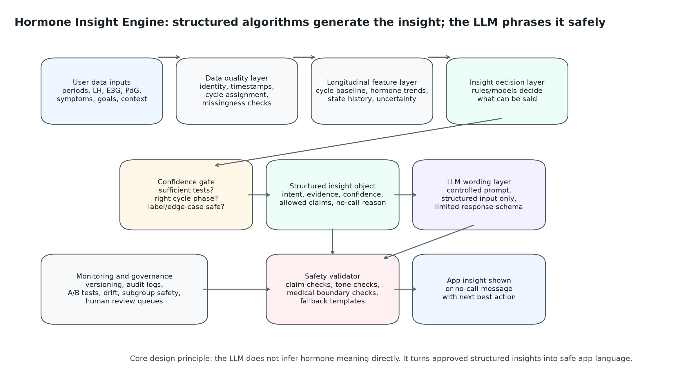

# Case Study 3: Hormone Insight Engine Architecture

## 1. Executive summary

This self-defined case study proposes an architecture for a longitudinal "Hormone Insight Engine" that generates personalised app insights from hormone and cycle data, with an LLM integrated into the system.

The short answer is:

> The LLM should not be the clinical or biological reasoning engine. The biological interpretation should come from validated longitudinal algorithms, confidence gates, and claim rules. The LLM should act as a controlled language layer that turns structured, approved insight objects into clear, personalised, safe app copy.

This distinction is the core design decision. A weak implementation would send raw hormone data to an LLM and ask it what it means. That would be difficult to validate, hard to monitor, and unsafe in a consumer health context. A safer implementation separates the system into:

1. a data and feature layer that understands longitudinal cycle context
2. an insight decision layer that decides what can be said
3. a confidence and safety layer that decides whether anything should be said
4. an LLM wording layer that phrases only approved structured insights
5. a validator that checks the generated message before it reaches the user

The product should be designed around calibrated, confidence-aware insights such as:

- "Your LH pattern suggests ovulation may be approaching."
- "Your PdG pattern is consistent with ovulation having occurred."
- "Your cycle appears more variable than your recent baseline."
- "More tests are needed this cycle before the platform can generate a reliable insight."

It should avoid unsupported claims such as:

- "You will ovulate tomorrow."
- "Your hormones are abnormal."
- "You may have PCOS."
- "Ovulation has been clinically confirmed."

## 2. Product goal and claim boundary

The Hormone Insight Engine should help users understand what their recent hormone and cycle patterns suggest, while staying inside the evidence boundary of the available data.

The engine should answer product questions such as:

| Product question | Example output |
|---|---|
| Is the fertile window likely approaching? | "Your estrogen pattern suggests your fertile window may be approaching." |
| Is ovulation likely soon? | "Your LH pattern suggests ovulation is likely soon." |
| Is there evidence consistent with ovulation after the LH rise? | "Your PdG pattern is consistent with ovulation having occurred." |
| Is this cycle unusual for this user? | "This cycle is running longer than your recent baseline." |
| Is there enough data to say anything? | "More tests are needed this cycle to generate a reliable insight." |

The engine should not diagnose, triage, or make medical claims unless those claims have been separately validated and approved. In the first product version, the safe claim boundary is:

> The platform can describe observed hormone and cycle patterns and explain what they may suggest for cycle tracking. The platform should not diagnose medical conditions or present algorithmic outputs as clinical certainty.

## 3. System architecture

The system should be built as a layered pipeline. Each layer has a clear responsibility, which makes the feature easier to validate, monitor, and explain.



| Layer | Responsibility | Why it matters |
|---|---|---|
| User data inputs | Period logs, LH, E3G, PdG, symptoms, app goal, cycle context, testing history | Defines the raw evidence available to the system |
| Data quality layer | Timestamp checks, duplicate handling, cycle assignment, missingness, plausible-value checks | Prevents bad data from becoming misleading insights |
| Longitudinal feature layer | User baselines, cycle phase, hormone trends, variability, data sufficiency, uncertainty | Converts raw time series into interpretable signals |
| Insight decision layer | Rules or models decide which insight candidates are biologically supported | Keeps biological reasoning outside the LLM |
| Confidence gate | Decides whether the evidence is strong enough to say something | Supports no-call behaviour rather than forced insight generation |
| Structured insight object | Machine-readable representation of the insight, evidence, confidence, and allowed wording | Creates a controllable interface between algorithms and the LLM |
| LLM wording layer | Converts approved insight objects into user-friendly language | Allows personalisation without uncontrolled inference |
| Safety validator | Checks generated text against claim rules, tone rules, and schema requirements | Prevents unsafe or unsupported messages from reaching users |
| Monitoring and governance | Versioning, audit logs, drift checks, subgroup performance, review queues | Makes the system maintainable after release |

## 4. Longitudinal data and feature layer

The feature layer should be user-centred and time-aware. It should use only information available at the time the insight is generated.

Core feature groups:

| Feature group | Examples | Product use |
|---|---|---|
| Cycle timing | Current cycle day, prior cycle lengths, expected ovulation window, cycle-length variability | Calendar prior and cycle-variability insights |
| LH dynamics | LH baseline, surge threshold crossing, peak-to-baseline ratio, time since surge | Near-term ovulation guidance |
| E3G dynamics | Early-cycle baseline, sustained rise, rise before LH, days since rise | Fertile-window approaching insights |
| PdG dynamics | PdG rise after LH, persistence over multiple tests, timing relative to suspected ovulation | Ovulation-consistency or confirmation-style insights |
| Data sufficiency | Number of tests this cycle, test timing, missing key phase, irregular testing | Confidence gating and no-call messages |
| User context | App goal, pregnancy/postpartum status if known, medications if collected, cycle regularity | Intended-use checks and safer personalisation |

The feature layer should distinguish predictors from confidence gates. Hormone trends may support an insight. Test density and missingness should usually decide whether the system has enough evidence to show that insight.

## 5. Insight decision layer

The insight decision layer should generate structured insight candidates before the LLM is called. This layer can start with transparent rules and later incorporate trained models where evidence supports doing so.

Example insight families:

| Insight family | Trigger logic | Example structured decision |
|---|---|---|
| Fertile window approaching | E3G rises above user's early-cycle baseline before LH surge | `fertile_window_approaching`, moderate confidence |
| Ovulation likely soon | Plausible LH surge detected in the appropriate cycle-day range | `ovulation_likely_soon`, high confidence if timing and test density are adequate |
| Ovulation likely occurred | PdG rise appears after a plausible LH surge | `ovulation_consistent_with_occurred`, moderate/high confidence |
| Cycle more variable than baseline | Current or recent cycles exceed user's own variability threshold | `cycle_variability_increased`, confidence depends on number of prior cycles |
| Need more data | Sparse tests, late cycle with no signal, contradictory pattern, unsupported context | `insufficient_data`, low confidence with recommended next action |

The decision layer should return no insight when the evidence is too weak. This is a product feature, not a failure. In health-adjacent products, silence or a carefully worded no-call is often safer than over-interpreting incomplete data.

## 6. Structured insight object

The structured insight object is the contract between the validated algorithmic layer and the LLM. It should contain enough information for personalised wording, but not invite the LLM to invent new clinical meaning.

Example:

```json
{
  "insight_id": "ovulation_likely_soon_lh",
  "insight_family": "ovulation_timing",
  "user_goal": "trying_to_conceive",
  "cycle_day": 13,
  "confidence": "high",
  "evidence": [
    {
      "signal": "LH",
      "finding": "plausible_surge_detected",
      "value": 18.4,
      "baseline_comparison": "above_user_baseline",
      "date": "2026-01-13"
    }
  ],
  "allowed_claims": [
    "LH pattern suggests ovulation may be approaching",
    "ovulation may be likely soon",
    "continue testing if prompted"
  ],
  "disallowed_claims": [
    "you will ovulate tomorrow",
    "you are definitely fertile",
    "clinical ovulation confirmation"
  ],
  "recommended_message_type": "near_term_guidance",
  "fallback_template": "Your LH pattern suggests ovulation may be likely soon. Keep following your recommended testing plan."
}
```

This object makes the system auditable. If a user sees an insight, the platform can trace which data, algorithm version, confidence gate, prompt version, and safety validator produced it.

## 7. LLM layer design

The LLM should receive only structured, pre-approved inputs. It should not receive a broad instruction such as "interpret this user's hormones."

Recommended LLM responsibilities:

- choose clear, empathetic wording for the approved insight
- adapt tone based on user goal and app context
- explain uncertainty in plain language
- include the approved next action when available
- keep within a strict response schema

The LLM should not:

- create new biological interpretations
- diagnose or suggest a condition
- override confidence gates
- transform low-confidence evidence into high-confidence language
- mention unsupported causes such as PCOS, infertility, miscarriage risk, or hormonal disorder
- invent missing data or imply clinical confirmation

The LLM output should be constrained to a small schema:

```json
{
  "title": "Ovulation may be approaching",
  "body": "Your LH pattern suggests ovulation may be likely soon.",
  "confidence_phrase": "Based on your recent tests",
  "next_action": "Keep following your recommended testing plan.",
  "safety_note": null
}
```

For many insights, a template may be enough. The LLM is most useful when there are multiple pieces of structured evidence to summarise, or when wording should adapt to the user's goal while preserving the same claim boundary.

## 8. Safety, limitations, and validation risks

The main safety risk is that an LLM could make the system appear more clinically certain than the underlying evidence supports.

Key risks and controls:

| Risk | Control |
|---|---|
| Hallucinated medical explanation | LLM receives structured insight objects only; validator blocks unsupported claims |
| Overconfident wording | Confidence phrase is generated from fixed allowed values |
| Diagnostic drift | Disallowed-claims library blocks condition-level language unless separately approved |
| Inconsistent messages across similar users | Prompt versioning, response schema, regression tests, and template fallback |
| Poor performance in subgroups | Monitor by cycle regularity, age, testing density, PCOS-like patterns, postpartum/pregnancy status, fertility-treatment context |
| Data sparsity | No-call and "need more tests" states are first-class outputs |
| Hidden model changes | Version algorithms, prompts, thresholds, and validators together |

The system should have a final automated validator before display. It should check:

- output is valid JSON
- title/body/next action are present
- no banned clinical claims are present
- confidence wording matches the structured confidence level
- no unsupported hormone, diagnosis, or timing claim has been added
- message length and reading level are appropriate for the app
- fallback template is used if validation fails

## 9. Validation and monitoring framework

Validation should be split into algorithm validation and language validation.

Algorithm validation:

- evaluate each insight family separately
- use prospective evaluation where the feature is meant to act in real time
- report sensitivity, specificity, precision, false reassurance, no-call rate, and timing error where relevant
- stratify by cycle regularity, data density, age, user goal, and unsupported contexts
- calibrate confidence labels so "high confidence" means the same thing across insight families
- run silent prospective validation before showing new insight types to users

Language validation:

- maintain a test set of structured insight objects and expected safe outputs
- run automated checks for banned claims and overconfident language
- perform human review for representative and edge-case messages
- test comprehension with users before release
- monitor post-release feedback, dismissals, support contacts, and behaviour changes

A useful release metric is not just "how often can the system generate an insight?" It is:

> How often can the system generate an insight that is correct enough, useful enough, safe enough, and understandable enough to show?

## 10. Product recommendation and next investment

The recommended build sequence is:

1. **Start with a rules-plus-threshold engine for a small set of high-value insights.**

   Begin with LH near-term guidance, E3G fertile-window approaching, PdG ovulation-consistency, cycle variability, and insufficient-data messages.

2. **Create structured insight objects before adding LLM wording.**

   This prevents the LLM from becoming the source of biological truth.

3. **Add confidence gates and no-call rules early.**

   The system should be comfortable saying "more data are needed."

4. **Use the LLM behind a strict schema and safety validator.**

   The first release could fall back to templates whenever validation fails.

5. **Run silent prospective validation.**

   Generate insights without showing them to users, then evaluate timing, accuracy, no-call rate, subgroup behaviour, and message burden.

6. **Move to controlled release with monitoring.**

   Start with low-risk educational and timing-support messages before considering more sensitive insights.

The first production candidate should not be a general hormone chatbot. It should be a constrained insight-generation system where the app can explain exactly why each message was shown and what evidence it used.

## 11. Bottom line

The Hormone Insight Engine should combine longitudinal algorithms with an LLM, but the LLM should not decide what the user's hormones mean. The safer and more scalable design is to generate structured, validated insight objects first, then use the LLM only to phrase those insights clearly within approved claim boundaries.
