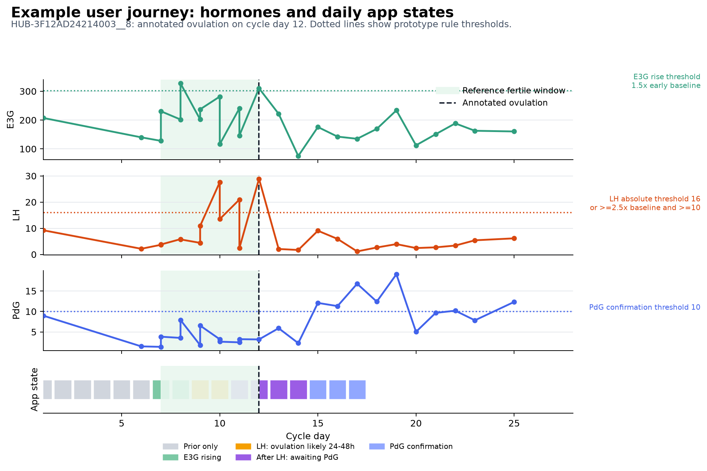
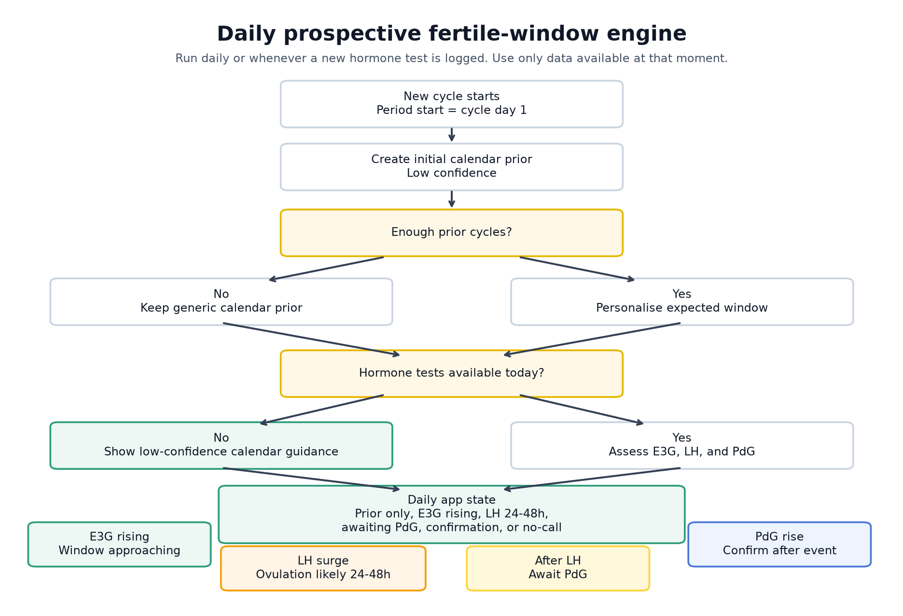

# Case Study 2: Fertile-Window and Ovulation Prediction Prototype

## 1. Executive summary

This self-defined case study designs and prototypes an approach that uses longitudinal hormone data plus logged period data to predict the fertile window or ovulation day, and expresses the result as a confidence window such as "ovulation likely in the next 24-48 hours."

The short answer is:

> Hormone data adds clear product value, but not by replacing calendar prediction entirely. In this regular no-PCOS sample, calendar-based fertile-window guidance already performs reasonably well. The value of LH, E3G, and PdG is that they make the guidance more specific, better timed, and able to support a narrower "ovulation likely in the next 24-48 hours" message.

The main result is not that hormones beat calendar prediction on every metric. They do not. The main result is that hormones enable a different and more valuable product behaviour: specific, time-sensitive guidance when ovulation is likely soon.

What this means for the platform:

| Question | Recommendation |
|---|---|
| Should the platform use calendar estimates? | Yes, for broad planning and early-cycle guidance |
| Should the platform use hormones? | Yes, for higher-specificity, near-term updates and ovulation confirmation |
| Should this be framed as an exact ovulation-date predictor? | No, it should be framed as confidence-aware daily guidance |
| Is this ready for a clinical claim? | No, it needs larger prospective validation and stronger labels |

This prototype should be treated as **product-oriented signal exploration**, not a locked clinical validation. The workbook ovulation dates are app-derived annotations, not independent clinical ground truth. The current result is useful for deciding how the platform should build and validate a fertile-window engine, but it should not be used to claim clinically validated ovulation prediction.

The most important framing is that there are two related but different analytical questions:

| View | Question | Product value |
|---|---|---|
| Prospective fertile-window guidance | What should the app tell the user today, using only data available up to today? | Directly useful for timing intercourse or insemination attempts |
| Retrospective ovulation reconstruction | After the cycle is complete, where was ovulation most likely? | Useful for validation, cycle summaries, model development, and PdG confirmation |

The user-facing product should be designed around the first view. A user trying to conceive needs timely daily guidance, not a highly accurate answer that only becomes available after the fertile window has passed.

The recommended product direction is a layered, confidence-aware fertile-window engine:

1. Start each cycle with a low-confidence calendar prior from the period start date.
2. Personalise the prior using the user's own recent cycle history when enough history exists.
3. Use E3G as an early signal that the fertile window may be approaching.
4. Use LH as the main near-term signal that ovulation is likely in the next 24-48 hours.
5. Use PdG mostly for retrospective confirmation, not forward prediction.
6. Return no confident call when data are sparse, late, contradictory, or outside the intended-use population.

The safest product language is not "you will ovulate tomorrow." It is closer to:

> "Your LH pattern suggests ovulation is likely in the next 24-48 hours."

or:

> "Your hormone pattern is consistent with ovulation having occurred after your LH rise."

## 2. Dataset and claim boundary

The prototype used `reference_pattern_cohort.xlsx`.

| Data source | Count |
|---|---:|
| Users | 20 |
| Cycle rows | 67 |
| Hormone rows | 4,018 |
| Real cycles with ovulation annotation | 67 |
| Detected ovulation annotations | 15 |
| Detected and PdG-confirmed annotations | 52 |

The workbook contains period start dates, cycle lengths, app-derived ovulation dates, LH surge timing, PdG rise dates, and longitudinal hormone tests for LH, E3G, PdG, FSH, and hCG.

The reference ovulation date was treated as a retrospective annotation, not clinical ground truth. The enum reference indicates that detected ovulation is based on LH peak timing, while detected-and-confirmed ovulation uses LH plus later PdG. Because this prototype also uses LH and PdG, there is label circularity.

Prospective daily evaluation makes that circularity less damaging because it prevents the model from using future information that would not have been available to the user at the time. For example, a day-10 prediction cannot use a later PdG rise or a later LH peak. That directly addresses the main product risk: appearing accurate only because the full cycle is already known.

However, prospective evaluation does not remove the weak-label issue completely. If the reference ovulation date is still the platform's own hormone-derived annotation, the correct claim is:

> This prototype prospectively aligns with reference ovulation annotations in the anonymized demonstration sample.

Not:

> This prototype has been clinically validated to predict true ovulation.

In this report, "confidence interval" is interpreted as a user-facing prediction window or decision interval, not a formal statistical confidence interval around a fitted parameter.

## 3. Product framing and physiology

Ovulation prediction is a sequential inference problem. The app starts each cycle with limited information, then updates the user's expected fertile window as new hormone tests arrive.

| Signal | Physiological meaning | Product use |
|---|---|---|
| Period start date | Defines cycle day 1 | Creates the initial low-confidence timing prior |
| Prior cycle lengths | Captures the user's recent cycle timing | Personalises the prior and uncertainty window |
| E3G rise | Estrogen metabolite rises during follicular development | Suggests the fertile window may be approaching |
| LH surge | LH rises shortly before ovulation | Strong near-term signal that ovulation is likely in roughly 24-48 hours |
| PdG rise | Progesterone metabolite rises after ovulation | Supports retrospective ovulation confirmation |

The practical interpretation is:

- E3G says "watch closely; the fertile window may be approaching."
- LH says "act now; ovulation is likely soon."
- PdG says "ovulation likely happened; use this to confirm and learn."

This matters because a retrospective model can look accurate while being less useful as a product. PdG can help identify ovulation after the event, but it does not help the user act before ovulation. Product success should therefore be judged by whether the app gives timely, calibrated, daily guidance before or during the fertile window.

The figure below shows one representative cycle. The green band is the reference fertile window, the dashed line is the annotated ovulation day, and the bottom row shows what the app-state engine would have shown as hormone evidence accumulated.



## 4. Method and time-leakage controls

The primary analysis was a **prospective daily simulation**. For every real annotated cycle, each cycle day was evaluated using only data available up to that date. This is closer to the app experience than evaluating only the final completed cycle.

Three prospective methods were compared:

| Method | What it uses | Product interpretation |
|---|---|---|
| Calendar-only | Period start date and a fixed cycle-day-9-to-14 fertile window | What a generic calendar app could say without personalisation or hormones |
| Cycle-history only | Period start date plus prior cycle lengths | What a personalised period-tracking app could say without hormones |
| Cycle + hormones | Cycle history plus E3G, LH, and PdG observed up to that day | What the platform can add through real-time hormone testing |

Two types of window are used:

| Window type | Meaning | How it is used |
|---|---|---|
| Fertile window | The days when intercourse or insemination timing may be useful | Used for broad planning and daily "fertile window may be open" states |
| Ovulation prediction window | The narrower interval when ovulation itself is expected | Used for messages such as "ovulation likely in the next 24-48 hours" |

The biological reference fertile window was defined as the five days before annotated ovulation plus the annotated ovulation day. This is a standard practical definition because sperm can survive for several days in fertile cervical mucus, while the egg is viable for a shorter period after ovulation. For specificity calculations, the day after annotated ovulation was treated as a transition buffer rather than a clear non-fertile day, because app states may reasonably be moving from "ovulation likely soon" into "awaiting/seeing confirmation" around that boundary.

The prototype returned the following windows by state:

| State | Predicted ovulation window | Predicted fertile-window meaning |
|---|---|---|
| Calendar-only window | Cycle days 13-15 | Generic fertile window on cycle days 9-14 |
| Cycle-history window | Median prior cycle length minus 14 days, widened by prior cycle variability | Five days before the lower bound of the ovulation window through the upper bound |
| E3G rising | First E3G rise +1 to +5 days | Fertile window may be approaching or open |
| LH surge 24-48h | LH surge day to LH surge +2 days | Near-term ovulation window; the most actionable forward-looking state |
| After LH, awaiting PdG | Same LH-based ovulation window | No new fertile-window call; wait for confirmation |
| PdG confirmation | First high PdG -6 to -2 days | Retrospective confirmation, not a forward fertile-window prediction |
| No confident call | No window returned | Insufficient or inconsistent evidence |

The daily state engine used this high-level flow:



The key leakage control is temporal:

> A prediction for a given cycle day can only use period history and hormone tests available on or before that day.

That means the product simulation cannot use a later LH peak, a later PdG rise, the final cycle length, or the final ovulation annotation to decide what the app would have shown earlier in the cycle.

The retrospective benchmark was kept as a secondary analysis. It asks a different question: after the cycle is complete, how close is the estimated ovulation date to the workbook annotation? That benchmark is useful for technical sanity checking, but it should not be treated as the main product validation.

## 5. Prospective product simulation results

The results are easiest to read as a tradeoff between coverage and specificity.

How to read the main metrics:

| Metric | Plain-language meaning |
|---|---|
| Fertile-day sensitivity | Of the true pre-ovulatory fertile days, how many received a broad actionable fertile-window state? |
| Non-fertile-day specificity | Of the non-fertile days, how many avoided an actionable fertile-window call? |
| Actionable-call precision | When the app made a broad actionable fertile-window call, how often was it actually in the reference fertile window? |
| False reassurance near ovulation | How often was the app quiet or low-confidence when ovulation was only 0-2 days away? |
| LH-alert PPV | When the app said "ovulation likely in 24-48h", how often was ovulation actually within 0-2 days? |

For these metrics, a **broad actionable fertile-window state** means either:

- `E3G rising`: user-facing meaning is "fertile window may be approaching or open; keep testing/consider timing attempts"
- `LH surge 24-48h`: user-facing meaning is "ovulation is likely soon"

The specific "ovulation likely in the next 24-48 hours" claim is evaluated separately using the LH-alert PPV metric. `After LH, awaiting PdG` and `PdG confirmation` are not counted as forward-looking actionable fertile-window states, because they are mainly confirmation or follow-up states.

The no-hormone methods were treated as benchmarks. They answer: what could a calendar or period-tracking product do before adding the platform hormone data?

| Benchmark | Fertile-day sensitivity | Specificity | Precision | False reassurance near ovulation | Near-term LH alert |
|---|---:|---:|---:|---:|---|
| Calendar-only | 61.9% | 85.1% | 62.1% | 6.1% | Not available |
| Cycle-history only | 87.8% | 55.3% | 45.8% | 2.4% | Not available |

The proposed platform-style method is the cycle+hormone engine. It answers a different product question: what extra value is created when the app can update the user's state from E3G, LH, and PdG observed up to that day?

| Proposed method | Fertile-day sensitivity | Specificity | Precision | False reassurance near ovulation | Near-term LH alert |
|---|---:|---:|---:|---:|---|
| Cycle + hormones | 49.8% | 96.9% | 80.0% | 2.1% | 73.6% PPV |

All three methods were evaluated across the same 1,302 cycle-days from 67 annotated real cycles.

Because the user-facing phrase "ovulation likely in the next 24-48 hours" depends on the chosen prediction window, the LH alert was also checked against nearby windows:

| LH-alert window tested | PPV |
|---|---:|
| Annotated ovulation same day | 41.5% |
| Annotated ovulation within 0-1 days | 68.9% |
| Annotated ovulation within 0-2 days | 73.6% |
| Annotated ovulation within 0-3 days | 75.5% |
| Annotated ovulation within -1 to +2 days | 96.2% |

The broader -1 to +2 day window is not proposed as a product claim. It is a sensitivity check acknowledging that the workbook annotation may not perfectly distinguish the exact biological ovulation day from adjacent LH/PdG-derived timing. Product wording should be selected after calibration on stronger prospective labels; based on this sample, "ovulation likely soon" or "likely in the next 1-2 days" may be safer than an over-literal claim.

The interpretation is not "hormones win on every metric." In this regular no-PCOS sample, calendar-only guidance performs reasonably well because many ovulations occur near the expected mid-cycle window. Cycle-history-only guidance catches more fertile days, but it does so by opening a much broader window, reducing specificity and precision.

The hormone-updated method is more selective. Compared with the benchmarks, it makes fewer broad fertile-window calls, so sensitivity is lower, but specificity and precision are higher. It also enables the main incremental product behaviour: a distinct LH-based "ovulation likely in the next 24-48 hours" message that no calendar-only or cycle-history-only method can provide.

This is the core product finding:

> Calendar methods are useful for broad planning. Hormone methods are useful for more specific, time-sensitive guidance.

## 6. Retrospective benchmark results

The retrospective benchmark evaluated each complete annotated cycle and compared the estimated ovulation date with the workbook annotation.

| Method | Cycles | Median absolute error | Mean absolute error | Within +/-1 day | Within +/-2 days | Interval coverage | Mean window width |
|---|---:|---:|---:|---:|---:|---:|---:|
| General cycle day 14 | 67 | 2.0 days | 2.40 days | 40.3% | 62.7% | 62.7% | 5.0 days |
| Manual period-history only | 67 | 2.0 days | 2.57 days | 35.8% | 64.2% | 73.1% | 6.9 days |
| Hormone-updated | 67 | 1.0 day | 0.70 days | 95.5% | 97.0% | 95.5% | 3.0 days |

The retrospective result shows that hormone data carries strong ovulation-timing signal in this sample. But this result should be interpreted carefully:

- the workbook ovulation annotation is itself hormone-derived
- PdG support can be retrospective rather than actionable
- final-cycle accuracy does not prove daily product usefulness
- the sample is small and limited to no-PCOS users

The retrospective benchmark is therefore useful supporting evidence, not the main product claim.

## 7. Implementation notes

The implementation was intentionally transparent. It should be read as a prototype state engine, not a final trained production model.

### Calendar-only

The calendar baseline used a fixed fertile window from cycle day 9 to cycle day 14.

Rationale:

- if ovulation is approximated as cycle day 14
- and the fertile window is the five days before ovulation plus ovulation day
- then a simple calendar app would flag cycle days 9-14

### Cycle-history only

The cycle-history model used logged period history but no hormone measurements. It only used previous cycles from the same user.

Calculation:

- collect previous cycle lengths for that user
- if no previous cycles exist, assume a 28-day cycle
- otherwise use the median previous cycle length
- central ovulation estimate = period start + median prior cycle length - 14 days
- uncertainty window width = based on the standard deviation of prior cycle lengths

Important detail:

> Prior cycle variability does not move the central estimate. It changes how wide the window should be around that estimate.

In code, the half-width was rounded from the standard deviation of previous cycle lengths and bounded between 2 and 6 days. A user with stable prior cycles gets a narrower window. A user with variable prior cycles gets a wider window.

### Hormone-updated

The hormone-updated method started from the cycle-history estimate, then updated it using hormone evidence observed up to that day.

The hormone thresholds were selected as transparent prototype heuristics, not as clinically validated cut-offs. The goal was to make the decision logic physiologically plausible and easy to inspect:

- E3G was treated as a **within-user rise signal**, because absolute E3G levels can vary by user, urine concentration, and testing pattern.
- LH was treated as a **near-term surge signal**, using both an absolute rule and a relative-to-baseline rule.
- PdG was treated as **retrospective confirmation**, because it usually rises after ovulation.

In a production model, these thresholds should be personalised, tuned on a larger development dataset, locked, and prospectively validated.

LH surge detection:

```text
1. On each simulated app day, keep only LH tests already observed up to that day.
2. Within those available-so-far tests, use cycle days 6-25 as the plausible LH-search range.
3. Calculate the LH baseline as the 25th percentile of the available-so-far LH values in that search range.
4. Flag a plausible LH surge if either:
   - LH >= 16, or
   - LH >= 2.5 x baseline and LH >= 10.
5. Sort surge candidates by test time.
6. Use the first plausible surge visible by that day, not the largest LH value anywhere in the completed cycle.
7. Predict ovulation as LH surge date + 1 day.
8. Set the prediction window as LH surge date to LH surge date + 2 days.
```

This is prospective in the daily product simulation because the baseline is recalculated from the LH tests available on that day only. For example, a cycle-day-10 app state cannot use LH values from cycle day 11 onwards. The cycle-day-6-to-25 restriction is only a biological search window to avoid treating very early or very late LH values as normal ovulatory surges.

The "first plausible surge" rule is important. An initial naive version selected the maximum LH value anywhere in the completed cycle. That created obvious failures when very late LH values appeared on cycle day 40, 74, 90, or later, and it also would not match the app experience. A real product must be prospective and time-aware; it cannot wait until the end of the cycle and pick the largest value after the fact.

The LH rule combines an absolute threshold with a relative threshold. `LH >= 16` captures clear high LH values. The `2.5 x baseline and >=10` rule captures users whose LH surge is meaningful relative to their own baseline, while the `>=10` floor prevents tiny baselines from creating false surge calls.

The daily state engine also uses simple state ordering. Once a plausible LH surge has been detected, the app should not revert to an "E3G rising" message. It should move from LH-based near-term guidance into an awaiting-confirmation state until PdG evidence appears or the cycle remains unresolved.

E3G logic:

```text
1. Search between cycle day 4 and cycle day 25.
2. Estimate early-cycle E3G baseline from the early available tests.
3. Flag E3G rise when E3G is at least 1.5 x baseline.
4. If no LH surge is present, treat the fertile window as approaching.
5. Use a wider window because E3G is an earlier, less precise signal.
```

The 1.5x E3G rule was used to avoid treating small daily noise as meaningful while still allowing an early estrogen rise to be detected before LH. It is deliberately relative to the user's own early-cycle baseline rather than a universal absolute threshold.

PdG logic:

```text
1. If PdG >= 10 and no useful LH/E3G prediction is available, use PdG as retrospective evidence.
2. Estimate that ovulation likely occurred several days earlier.
3. Assign low confidence for forward prediction because PdG usually rises after ovulation.
```

The PdG `>=10` rule was used as a conservative prototype marker of post-ovulatory elevation, not as a forward fertile-window signal.

## 8. Safety, limitations, and validation risks

The current prototype is not ready for production release. The main limitations are:

1. **The reference labels are app-derived.** The benchmark is not independent clinical validation.
2. **The sample is small.** There are only 20 users and 67 evaluable cycles.
3. **The sample is not representative of all intended users.** It only uses the no-PCOS workbook and does not stress-test irregular cycles, suspected PCOS, anovulatory cycles, postpartum cycles, medication effects, or fertility-treatment contexts.
4. **Hormone testing is dense in many cycles.** Real-world users may test less consistently, later, or at the wrong point in the cycle.
5. **The thresholds are heuristic.** LH, E3G, and PdG thresholds should be personalised and validated on larger data before deployment.
6. **Confidence is not fully calibrated.** Current confidence labels are rule-based and should be calibrated against prospective outcomes.
7. **User-facing wording carries risk.** Overconfident fertility messages can create false reassurance, anxiety, or poorly timed attempts.

The prospective simulation reduces time leakage but does not solve all validation problems. A stronger validation would require a locked algorithm tested prospectively on a larger, representative dataset, ideally with stronger ovulation labels where available.

## 9. Product recommendation and next investment

This is safe to develop further as an evidence-aware ovulation guidance feature, but not as a deterministic ovulation-date predictor.

Appropriate product claims:

- "Your LH pattern suggests ovulation is likely in the next 24-48 hours."
- "Your estrogen pattern suggests your fertile window may be approaching."
- "Your PdG pattern is consistent with ovulation having occurred."
- "More tests are needed to estimate this cycle confidently."

Claims to avoid:

- "You will ovulate tomorrow."
- "You are definitely fertile today."
- "Ovulation has been clinically confirmed."
- "This result applies equally to irregular cycles, PCOS, postpartum, or fertility-treatment users."

Recommended next investment:

1. Keep the retrospective ovulation-date prototype as a technical benchmark.
2. Treat the daily prospective state engine as the actual product prototype.
3. Evaluate the daily engine using only data available at each decision point.
4. Add explicit no-call rules for sparse, late, inconsistent, or unsupported data.
5. Retrain and tune thresholds on a larger dataset with broader cycle types.
6. Calibrate confidence windows so "24-48 hours" means what it says.
7. Lock the algorithm and run silent prospective validation before broad user-facing release.

## 10. Bottom line

> The hormone signal is real and product-relevant, but the right feature is not a deterministic ovulation date. The right feature is timely, confidence-aware daily guidance that combines broad calendar planning with hormone-driven near-term updates.
