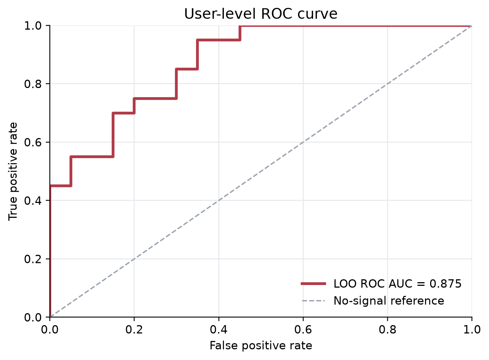
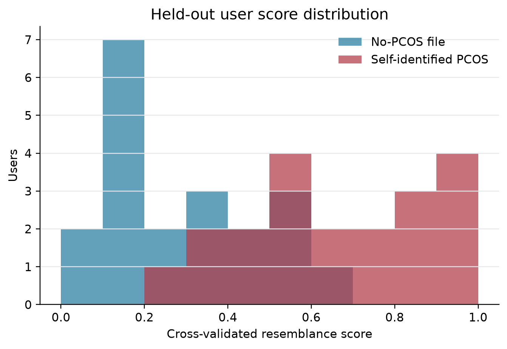
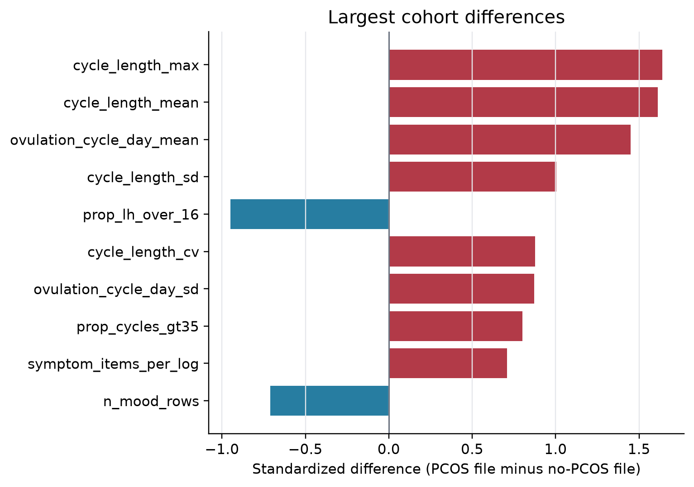

# Case Study 1: PCOS-Pattern Resemblance Prototype

## 1. Executive summary

This self-defined case study builds a model or score that estimates whether a user's data pattern resembles the self-identified PCOS group, then evaluates whether that signal could ever be surfaced safely in a consumer app.

The short answer is:

> The anonymized demonstration data contains a plausible separation signal between the two groups, mostly driven by longer and more variable cycles in the self-identified PCOS file. This is useful as a proof of concept, but it is not safe to surface as a PCOS prediction, probability, diagnosis, or medical risk score.

This analysis should be treated as **proof-of-concept signal exploration**, not a locked model validation. The dataset is small, artificially balanced, and based on self-reported PCOS status. It is suitable for asking whether the platform should invest in a larger, properly designed modelling and validation effort. It is not suitable for making a production or clinical claim.

The recommended next step is to invest in a larger retrospective development dataset with better labels and broader user representation, retrain the model properly, lock the model and operating thresholds, and only then run silent prospective validation before considering any user-facing insight.

The safest possible product direction is not "you may have PCOS." It is closer to:

> "Your recent cycles appear more variable than expected. The platform cannot diagnose PCOS, but persistent irregular cycles or symptoms may be worth discussing with a clinician."

Even that type of wording should only be considered after stronger validation and human-factors testing.

## 2. Dataset and claim boundary

The data consists of two Excel workbooks:

| Group | Users | Cycle rows | Hormone rows |
|---|---:|---:|---:|
| Self-identified PCOS | 20 | 75 | 5,231 |
| No-PCOS file | 20 | 67 | 4,018 |

Each workbook contains cycle data, urine hormone tests, user information, pregnancy logs, mood logs, symptom logs, and enum references.

The target label used in this prototype is workbook membership:

- `1`: user appears in the PCOS workbook
- `0`: user appears in the no-PCOS workbook

This is not the same as clinician-confirmed PCOS. That distinction is central to the interpretation. PCOS is a clinical syndrome that usually requires evidence across diagnostic axes such as ovulatory dysfunction, hyperandrogenism, ovarian morphology or AMH, and exclusion of other causes. The demonstration data does not include testosterone, free androgen index, SHBG, DHEAS, AMH, ultrasound morphology, BMI, metabolic labs, medication history, or formal differential diagnosis.

Therefore, the appropriate claim boundary is:

> This prototype estimates resemblance to the anonymized self-identified PCOS-pattern cohort based on observed cycle and hormone patterns.

Not:

> This prototype detects PCOS.

## 3. Method and leakage controls

The main modelling unit is the **user**, not the cycle row or hormone row. This matters because each user contributes repeated measurements. If cycle or hormone rows were randomly split into train and validation sets, the same user's data could appear on both sides of the split, making the model look better than it really is.

The modelling pipeline was:

1. Load both workbooks.
2. Assign the label from workbook membership.
3. Exclude direct label text such as `Conditions`, because it contains PCOS status and would create trivial leakage.
4. Convert each user into one row of longitudinal summary features.
5. Build a conservative `cycle_hormone_core` score using cycle timing and raw hormone summaries.
6. Validate using leave-one-user-out cross-validation.
7. Translate held-out scores into exploratory resemblance bands.

The main feature groups were:

| Feature group | Examples | Why included | Main caution |
|---|---|---|---|
| Cycle timing | `cycle_length_mean`, `cycle_length_max`, `prop_cycles_gt35` | PCOS-like ovulatory dysfunction can produce longer cycles | Not specific to PCOS |
| Cycle variability | `cycle_length_sd`, `cycle_length_cv` | Irregular ovulation can produce unstable cycle timing | Needs multiple observed cycles |
| LH features | `lh_median`, `lh_max`, `prop_lh_over_16` | LH dynamics are central to ovulation | Strongly affected by test timing |
| E3G features | `e3g_median`, `e3g_max` | E3G reflects estrogen activity during follicle development | Needs cycle-day context |
| PdG features | `pdg_median`, `pdg_max`, `prop_pdg_over_10` | PdG reflects post-ovulatory progesterone activity | Needs cycle-day context |
| FSH | `fsh_median` | FSH supports follicle recruitment | Weak standalone signal here |
| Symptom and mood features | `symptom_items_per_log`, `mean_symptom_level`, `mood_codes_per_log`, `prop_skin_logs` | Symptoms and mood may reflect cycle burden or androgen-related concerns | Sparse, non-specific, and engagement-dependent |
| Data sufficiency features | `n_hormone_rows`, `hormone_test_days_per_cycle`, `n_cycles` | Indicates whether there is enough data to say anything | Candidate future confidence gates, not clinical evidence |

App-derived annotations such as ovulation date, ovulation type, LH surge time, and PdG rise date were treated cautiously. They are biologically meaningful, but may be generated by the platform's existing algorithms. They should not be the primary evidence for validating a new platform model because that can create circularity.

Diary and engagement features were also treated cautiously. Mood and symptoms may be relevant, but sparse logs and testing frequency can reflect user behaviour, app guidance, or concern level rather than biology.

No formal confidence gate was locked or applied in this proof-of-concept analysis. Cycle count, hormone testing density, and diary completeness were evaluated as data-sufficiency diagnostics. They are recommended as candidate confidence-gating variables for a future validated product workflow, not as finalized rules from this dataset.

The analysis was implemented in Python with reproducible scripts for feature generation, validation, cold-start analysis, subgroup diagnostics, example users, and bootstrap confidence intervals.

## 4. Why leave-one-user-out was used

There are only 40 users. A conventional 70/30 train/test split would leave roughly 12 users in the test set, which is too small for a stable estimate. Leave-one-user-out is a reasonable prototype choice because every user receives one out-of-sample prediction while keeping all measurements from that user out of the training fold.

For each fold:

1. hold out one user
2. train the score on the other 39 users
3. score the held-out user
4. repeat until all 40 users have a held-out score

This answers a limited but useful question:

> Can this feature approach rank held-out users in this small dataset without training on that same user?

It does not answer:

> Is this model validated for real-world app deployment?

This is **not** a locked-model validation. With this sample size, no final feature set, threshold, product band, or model should be considered frozen. The results are best interpreted as evidence about whether the concept is promising enough to justify further investment.

Leave-one-user-out has important disadvantages:

- performance estimates are high-variance with only 40 users
- feature choices and interpretation were still influenced by the same dataset
- it is not an independent external validation
- it cannot establish calibration or production thresholds
- it cannot support a regulatory, clinical, or deployment-readiness claim

For a true validation, the platform would need a locked model evaluated once on an independent cohort representative of the intended app population.

## 5. What the analysis found

The conservative `cycle_hormone_core` score showed clear separation between the two demonstration groups under leave-one-user-out validation.

The key performance metrics are ranking metrics rather than deployment decisions. They answer whether the score tends to rank users from the PCOS-labelled workbook above users from the no-PCOS workbook. They do not prove that the score is clinically calibrated, safe to surface, or ready to assign individual risk.

| Metric | Result |
|---|---:|
| Users | 40 |
| Self-identified PCOS users | 20 |
| Leave-one-user-out ROC AUC | 0.875 [0.759-0.964] |
| Leave-one-user-out average precision | 0.883 [0.759-0.971] |
| Median-threshold sensitivity | 0.750 [0.611-0.947] |
| Median-threshold specificity | 0.750 [0.588-0.938] |

Plain-language interpretation:

| Metric | What it means | How to interpret it here |
|---|---|---|
| ROC AUC | If one PCOS-labelled user and one no-PCOS-labelled user are picked at random, ROC AUC is the probability that the model gives the PCOS-labelled user the higher score. | 0.875 means the score ranked the PCOS-labelled user higher in about 88% of these pairwise comparisons. This suggests signal, but it does not mean the model is 88% accurate in real app users. |
| Average precision | A precision-recall summary that focuses on how many true PCOS-labelled users appear near the top of the ranked list. It is useful when the positive class may be rarer in the real world. | 0.883 suggests the high-scoring users were enriched for the PCOS-labelled workbook in this balanced sample. It does not tell us the real-world positive predictive value because the dataset prevalence is artificial. |
| Sensitivity | Among PCOS-labelled users, the share flagged above a chosen threshold. | At the median threshold, 75% of PCOS-labelled users were above the threshold. Missing 25% is not acceptable for a clinical claim. |
| Specificity | Among no-PCOS-labelled users, the share correctly below the threshold. | At the median threshold, 75% of no-PCOS-labelled users were below the threshold. A 25% false-positive rate would be too high for a PCOS-facing product message. |
| Confidence interval | A bootstrap estimate of how much the metric could vary because the sample is small. | The intervals are wide, which means the result is promising but unstable. More users are needed before making decisions about thresholds or product claims. |

The point estimate is promising, but the confidence intervals are wide. That width is part of the result: with 40 users, the apparent performance is uncertain.

The ROC curve shows the trade-off between sensitivity and false-positive rate across all possible thresholds. A curve well above the diagonal suggests separation between the two workbook groups, but the small sample means the curve should be read as proof-of-concept evidence rather than validation.

The model separated exploratory score bands as follows:

| Band | Users | PCOS-labelled users | PCOS-labelled share |
|---|---:|---:|---:|
| Lower resemblance | 14 | 1 | 7.1% |
| Indeterminate | 13 | 8 | 61.5% |
| Higher resemblance | 13 | 11 | 84.6% |

These bands are useful for understanding whether the signal exists. They should not be treated as product-ready thresholds.

The score distribution below gives the same message visually: the two groups are separated, but they are not perfectly separated. The overlap is the important product risk. A user in the middle of the distribution could easily be misclassified if this were turned into a user-facing score.

The strongest group differences were cycle-related:

| Feature | PCOS mean | No-PCOS mean | Interpretation |
|---|---:|---:|---|
| Maximum cycle length | 37.0 | 28.9 | Longer cycles in the PCOS file |
| Mean cycle length | 32.4 | 27.2 | Higher average cycle length in the PCOS file |
| Mean ovulation cycle day | 20.4 | 14.5 | Later annotated ovulation in the PCOS file |
| Cycle-length SD | 4.1 | 1.8 | More cycle variability in the PCOS file |
| Proportion cycles >35 days | 0.163 | 0.000 | Long cycles occurred mainly in the PCOS file |

This is biologically plausible, but it also narrows the interpretation. The current score is probably detecting a **cycle-irregularity phenotype** more than PCOS itself.

The feature-difference plot reinforces that point. The largest separation comes from cycle length, cycle variability, and later annotated ovulation timing. Those are plausible PCOS-associated patterns, but they are not specific enough to support a PCOS diagnosis.

## 6. Cold-start, cycle count, and engagement

The earliest this type of score could use cycle-length information is **after one full cycle has completed**. It cannot know final cycle length during the first cycle.

To test how much signal exists at the earliest possible point, a first-cycle-only simulation was run. For each user, only the earliest completed observed cycle and hormone/diary rows within that first-cycle window were used. The same leave-one-user-out procedure was then repeated.

| Analysis | Cycle history used | Users | Mean hormone rows/user | Features used | LOO ROC AUC | LOO average precision |
|---|---|---:|---:|---:|---:|---:|
| Full-history primary model | All observed cycles | 40 | 231.2 | 16 | 0.875 [0.759-0.964] | 0.883 [0.759-0.971] |
| First-cycle-only simulation | First completed observed cycle only | 40 | 47.2 | 14 | 0.788 [0.625-0.931] | 0.805 [0.631-0.955] |

The first completed cycle contains some signal, but performance is weaker and more uncertain. It also produced stress cases, including a no-PCOS-labelled user with a high score. That makes first-cycle scoring too unstable for user-facing interpretation.

Subgroup diagnostics using the full-history scores were also run by cycle history, hormone testing density, and diary engagement:

| Subgroup | Level | Users | PCOS users | ROC AUC | Average precision | Accuracy at 0.5 |
|---|---|---:|---:|---:|---:|---:|
| Cycle history | 3 cycles | 27 | 12 | 0.889 | 0.889 | 0.778 |
| Cycle history | 4+ cycles | 13 | 8 | 0.975 | 0.986 | 0.769 |
| Hormone testing density | Lower tertile | 14 | 6 | 0.917 | 0.897 | 0.857 |
| Hormone testing density | Middle tertile | 14 | 5 | 0.844 | 0.833 | 0.714 |
| Hormone testing density | Higher tertile | 12 | 9 | 0.889 | 0.963 | 0.750 |
| Diary engagement | 1-10 diary logs | 24 | 15 | 0.896 | 0.933 | 0.792 |
| Diary engagement | 11+ diary logs | 15 | 5 | 0.860 | 0.833 | 0.733 |

These subgroup results are underpowered. They do not show a clean pattern where more engagement automatically improves performance. That is important for product design: more tests or more diary logs are not the same as better biological evidence. Timing and relevance matter more than raw volume.

Working assumption:

> A PCOS-pattern resemblance score should not be generated before at least one full cycle has completed, and one completed cycle is still not enough for user-facing interpretation. A reasonable prototype gate would require at least 3 completed cycles or equivalent hormone history before producing an internal score.

This is an illustrative product assumption, not a validated threshold. No score was suppressed by a formal confidence gate in the current analysis. For user-facing insights, any gate should be learned or confirmed during the next development phase, then locked before silent prospective validation.

## 7. Safety, limitations, and validation risks

The current prototype is not ready for user-facing release as a PCOS score. The main value of the analysis is to show that a biologically plausible signal exists and that it may be worth investing in a stronger development and validation pathway.

The result is not safe to surface as:

- "You may have PCOS"
- "Your PCOS risk is high"
- "Your hormones look like PCOS"
- a numerical PCOS probability
- a diagnostic or triage recommendation
- an LLM-generated interpretation of PCOS likelihood

The main reasons are:

1. **The labels are self-reported.** The model is not trained against clinician-confirmed PCOS.
2. **The sample is artificially balanced.** The dataset is 50:50 PCOS/no-PCOS, while real app prevalence is likely much lower.
3. **Core diagnostic dimensions are missing.** There are no androgen labs, AMH, ultrasound, BMI/metabolic markers, medication history, or formal exclusion of other causes.
4. **The strongest signal is not specific.** Longer and more variable cycles can occur for reasons other than PCOS.
5. **The sample is too small.** Confidence intervals are wide and subgroup reliability cannot be established.
6. **User harm is plausible.** A PCOS-like message could cause anxiety, false reassurance, unnecessary care-seeking, or delayed care.

A safer future product direction would be a non-diagnostic cycle-pattern insight, for example:

> "Your recent cycles appear more variable than your usual pattern. The platform cannot diagnose medical conditions, but persistent irregular cycles or symptoms may be worth discussing with a clinician."

Even this should not be released from the current model. It would need stronger validation and carefully tested wording.

## 8. Product recommendation and next investment

Product recommendation:

| Potential use | Recommendation | Rationale |
|---|---|---|
| Internal research score | Reasonable | The signal is plausible and useful for deciding whether to invest further |
| Larger retrospective model development | Recommended | Needed before any locked model exists |
| Silent prospective validation | Recommended after model locking | Needed to test real-world behaviour without affecting users |
| Clinician/research dashboard flag | Possible later with safeguards | Could support review if clearly non-diagnostic |
| User-facing PCOS probability | Do not release | Labels, prevalence, and missing diagnostic axes make this unsafe |
| User-facing diagnostic language | Do not release | The data cannot establish PCOS |
| Conservative cycle-variability education | Possible later | Safer than a PCOS claim, but still needs validation |
| LLM-generated PCOS interpretation | Do not allow directly | LLMs should only phrase structured, confidence-gated outputs |

The right next step is not to polish this score for launch. The right next step is to decide whether to invest in a proper development and validation pathway.

Recommended sequence:

1. **Build a larger retrospective development dataset.**

   Include a much larger, app-representative set of users, not a balanced 50:50 case-control sample.

2. **Improve label quality.**

   Use clinician-confirmed PCOS where possible, or at minimum an adjudicated label that separates confirmed PCOS, suspected PCOS, no PCOS, and relevant differential diagnoses.

3. **Collect missing clinical context.**

   Prioritize variables that matter for PCOS interpretation: hyperandrogenism, AMH/ultrasound if available, BMI/metabolic context, medications, hormonal contraception, postpartum/pregnancy status, thyroid disease, endometriosis, fertility treatment, and cycle-history context.

4. **Engineer better longitudinal hormone features.**

   Current hormone summaries are blunt. A better model should use cycle-day aligned features:

   - follicular E3G rise
   - LH surge sharpness
   - LH peak-to-baseline ratio
   - days from E3G rise to LH surge
   - PdG rise 3-7 days after LH
   - luteal PdG persistence
   - multiple LH peaks
   - cycles with no detected LH surge

5. **Separate predictors from confidence gates.**

   Testing density, diary completeness, and cycle count should primarily determine whether the system has enough data to say anything. They should not quietly become clinical predictors.

6. **Lock the model before validation.**

   The feature set, preprocessing, model, thresholds, confidence gates, and analysis plan should be frozen before opening the validation cohort.

7. **Run silent prospective validation.**

   The model should generate scores without showing them to users. Evaluation should include ranking, calibration, false-positive burden, subgroup performance, and stability across time.

8. **Test the user experience before surfacing anything.**

   If a cycle-variability insight is considered, test whether users understand it as non-diagnostic, whether it increases anxiety, whether it causes false reassurance, and whether it prompts appropriate care-seeking.

Minimum validation outputs should include:

- ROC AUC and PR AUC
- calibration diagnostics if probabilities are considered
- PPV/NPV at real app prevalence
- alert or insight burden
- subgroup performance by age, goal, cycle regularity, testing density, medication context, pregnancy/postpartum status, thyroid disease, and endometriosis
- performance by data maturity: 1, 2, 3, 4-6, and 6+ completed cycles
- false-positive and false-negative case review
- human-factors results for any user-facing language

## 9. Bottom line

The analysis finds a biologically plausible signal in the demonstration data. The signal is strongest for cycle length and variability, which fits a PCOS-pattern hypothesis but is not specific enough to support a PCOS claim.

The current work is valuable as a proof of concept. It suggests that the platform may have enough longitudinal signal to justify a larger, more rigorous modelling effort. It does not justify surfacing a PCOS score in the app.

## Appendix: Feature glossary

This appendix explains the user-level features generated for the PCOS-pattern resemblance prototype. The score is not diagnosing PCOS; it estimates whether a user's observed cycle and hormone patterns resemble the self-identified PCOS cohort in the demonstration dataset.

How to read the glossary:

- **Calculation** describes how the feature was created from the workbook.
- **Physiological plausibility** explains why the feature could plausibly separate PCOS-like patterns from non-PCOS patterns.
- **Observed direction** describes the pattern in this dataset, not a universal biological truth.
- **Caveat** explains why the feature should not be overinterpreted.

### Primary cycle and hormone features

These are the 16 features used in the conservative `cycle_hormone_core` model.

| Feature | What it measures | Calculation | Physiological plausibility | Observed direction | Caveat |
|---|---|---|---|---|---|
| `cycle_length_mean` | Average cycle length | Mean of `Cycle Length (days)` per user | PCOS is commonly associated with ovulatory dysfunction, longer follicular phases, and oligomenorrhea | Higher in PCOS file | Cycle length can be affected by stress, thyroid disease, postpartum state, medications, birth-control changes, and data completeness |
| `cycle_length_sd` | Cycle-to-cycle variability | Standard deviation of cycle length per user | Irregular ovulation can produce more variable cycle timing | Higher in PCOS file | Requires multiple observed cycles; unstable with few cycles |
| `cycle_length_cv` | Relative cycle variability | `cycle_length_sd / cycle_length_mean` | Captures irregularity adjusted for average cycle length | Higher in PCOS file | Sensitive to small denominators and few cycles |
| `cycle_length_max` | Longest observed cycle | Maximum cycle length per user | Long cycles are consistent with delayed ovulation or anovulatory intervals | Higher in PCOS file | One unusual cycle can dominate this feature |
| `prop_cycles_gt35` | Share of long cycles | Proportion of cycles >35 days | Adult cycles >35 days are a common marker of cycle irregularity or oligo-ovulation | Higher in PCOS file | Threshold is clinically meaningful but not diagnostic |
| `lh_median` | Typical LH level | Median urinary LH across hormone tests | Some PCOS phenotypes have altered LH pulsatility or higher LH relative to FSH | Slightly lower in PCOS file | Urinary LH is timing-sensitive; a median can miss surge dynamics |
| `lh_max` | Highest observed LH | Maximum urinary LH across tests | LH surges are central to ovulation timing; abnormal or repeated LH patterns may occur in irregular cycles | Lower in PCOS file | Max LH depends heavily on whether the user tested near the surge |
| `lh_peak_to_median` | LH surge prominence | `lh_max / lh_median` | Strong surges may indicate clearer ovulatory cycles; flatter or missed surges may reflect sparse testing or irregular ovulation | Slightly lower in PCOS file | Can be distorted by low medians or missed surge tests |
| `prop_lh_over_16` | Frequency of elevated LH tests | Proportion of LH tests >=16 | Elevated LH tests may reflect surge frequency or high baseline LH | Lower in PCOS file | Threshold depends on device/app conventions and testing timing |
| `e3g_median` | Typical estrogen metabolite level | Median urinary E3G across hormone tests | E3G reflects estrogen activity from developing follicles; altered follicular dynamics may change E3G patterns | Higher in PCOS file | E3G is affected by urine concentration, timing, and test selection |
| `e3g_max` | Highest observed E3G | Maximum urinary E3G across tests | High estrogen-metabolite values may reflect follicular activity before ovulation | Higher in PCOS file | Max values are sensitive to outliers and testing density |
| `pdg_median` | Typical progesterone metabolite level | Median urinary PdG across tests | PdG rises after ovulation; luteal progesterone patterns can indicate whether ovulation was followed by corpus luteum activity | Slightly higher in PCOS file | Median over all cycle days mixes follicular and luteal phases |
| `pdg_max` | Highest observed PdG | Maximum urinary PdG across tests | A high post-ovulatory PdG value can support ovulation/luteal activity | Slightly higher in PCOS file | Max PdG depends on whether the user tested in luteal phase |
| `prop_pdg_over_5` | Frequency of moderate PdG elevation | Proportion of PdG tests >=5 | Repeated PdG elevations may suggest luteal-phase progesterone activity | Higher in PCOS file | Threshold is not a standalone ovulation-confirmation rule |
| `prop_pdg_over_10` | Frequency of stronger PdG elevation | Proportion of PdG tests >=10 | Stronger PdG elevations may reflect clearer luteal progesterone activity | Higher in PCOS file | Needs cycle-day context; frequent luteal testing can inflate it |
| `fsh_median` | Typical FSH level | Median urinary FSH across tests | FSH supports follicle recruitment; altered gonadotropin dynamics may be relevant to ovulatory dysfunction | Similar between groups | FSH is secondary here and not enough to infer PCOS physiology |

### Additional cycle annotation features

These were used in sensitivity analyses because some may be derived by existing app algorithms rather than raw observations.

| Feature | What it measures | Calculation | Physiological plausibility | Caveat |
|---|---|---|---|---|
| `ovulation_cycle_day_mean` | Average ovulation timing within cycle | Mean days from period start to annotated ovulation date | Later ovulation is consistent with a longer follicular phase | May be algorithm-derived; can create circularity if used as primary evidence |
| `ovulation_cycle_day_sd` | Variability of ovulation timing | Standard deviation of annotated ovulation cycle day | Irregular follicular development can produce variable ovulation timing | Requires reliable ovulation annotations |
| `pdg_rise_cycle_prop` | Share of cycles with PdG rise annotation | Cycles with non-empty `date_PDG_rise` divided by cycles | PdG rise after ovulation supports luteal progesterone activity | May depend on test adherence and existing app rules |
| `detected_confirmed_ovulation_prop` | Share of cycles detected and PdG-confirmed | Proportion of cycles where ovulation type is `23` | Combines LH detection with PdG confirmation | App-derived field; should not be primary raw-signal evidence |
| `annotated_lh_peak_*` | LH peak annotations from cycle sheet | Summary of `LH Peak Value` per user | LH peak timing/value is central to ovulation detection | App-annotation feature; raw hormone features are safer for primary modelling |

### Diary and symptom features

These features were generated but treated cautiously. They may capture real symptoms, but they can also capture logging behaviour.

| Feature | What it measures | Calculation | Physiological plausibility | Caveat |
|---|---|---|---|---|
| `symptom_items_per_log` | Symptom burden per symptom log | Total symptom items divided by symptom logs | PCOS can be associated with symptoms such as acne, cycle irregularity, fatigue, mood burden, and metabolic symptoms | Symptoms are non-specific and sparse |
| `mean_symptom_level` | Average reported symptom severity | Mean symptom level excluding placeholder values such as 99 | More severe/recurrent symptoms may correlate with endocrine or cycle disruption | Self-report scale meaning needs enum review |
| `symptom_item_count` | Total symptom items logged | Count of JSON symptom entries | More symptoms may reflect higher burden | Strongly affected by engagement/logging frequency |
| `mood_codes_per_log` | Number of mood selections per mood log | Count comma-separated mood codes | Mood symptoms can fluctuate with hormones and PCOS-associated psychological burden | Non-specific; may reflect UI behaviour |
| `feeling_codes_per_log` | Number of feeling selections per mood log | Count comma-separated feeling codes | Could reflect fatigue, focus, anxiety, low mood, or sleep issues | Non-specific and sparse |
| `prop_exercise_sluggish_logs` | Sluggish exercise-related entries | Share of mood logs where exercise = `sluggish` | Energy and exercise tolerance may vary with cycle and endocrine state | Not PCOS-specific |
| `prop_skin_logs` | Skin-related diary entries | Share of mood logs with a skin value | Skin symptoms can proxy androgen-related acne concerns | Code mapping needs careful review; not equivalent to measured hyperandrogenism |

### Data sufficiency and app-behaviour features

These features are useful for quality control and future confidence gating, but they are risky as predictors because they may reflect user behaviour rather than biology. No formal confidence gate was locked or applied in this proof-of-concept analysis.

| Feature | What it measures | Calculation | Why it may matter | Caveat |
|---|---|---|---|---|
| `n_cycles` / `n_real_cycles` | Available cycle history | Count of cycle rows and real-cycle rows per user | More cycles make longitudinal estimates more reliable | Can reflect tenure or engagement |
| `n_hormone_rows` | Hormone testing volume | Count of hormone rows per user | More tests improve signal reliability | Testing intensity may differ by concern level or app guidance |
| `unique_hormone_test_days` | Unique days with hormone tests | Count of unique test dates | Useful for data sufficiency | Not a biological signal |
| `hormone_test_days_per_cycle` | Testing density | Unique hormone-test days divided by cycle count | Helps assess confidence in cycle/hormone summaries | Can act as an engagement artifact |
| `n_mood_rows` / `n_symptom_rows` | Diary logging volume | Count diary rows per user | Useful for confidence in symptom features | Should not drive a clinical score |
| `n_pregnancy_rows` | Pregnancy diary entries | Count pregnancy logs per user | Pregnancy can alter hormones and should be handled separately | Pregnancy cycles should be excluded or stratified |
| `hcg_*` | hCG summaries | Summary of hCG rows | hCG is relevant to pregnancy status | Not relevant to PCOS-pattern scoring except as exclusion/context |

### Demographic and context features

| Feature | What it measures | Calculation | Why it may matter | Caveat |
|---|---|---|---|---|
| `age` | User age | User info sheet | Cycle regularity, ovarian reserve, fertility goals, and PCOS phenotype vary by age | Small sample; age can confound cohort differences |
| `goal` | App goal code | User info sheet | Goal may influence testing/logging behaviour | Product-behaviour feature, not direct biology |
